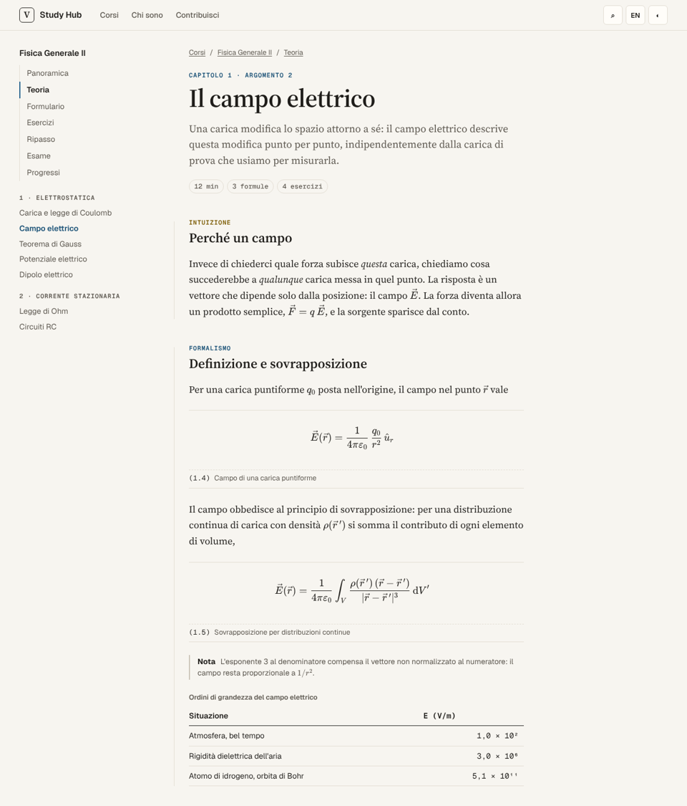
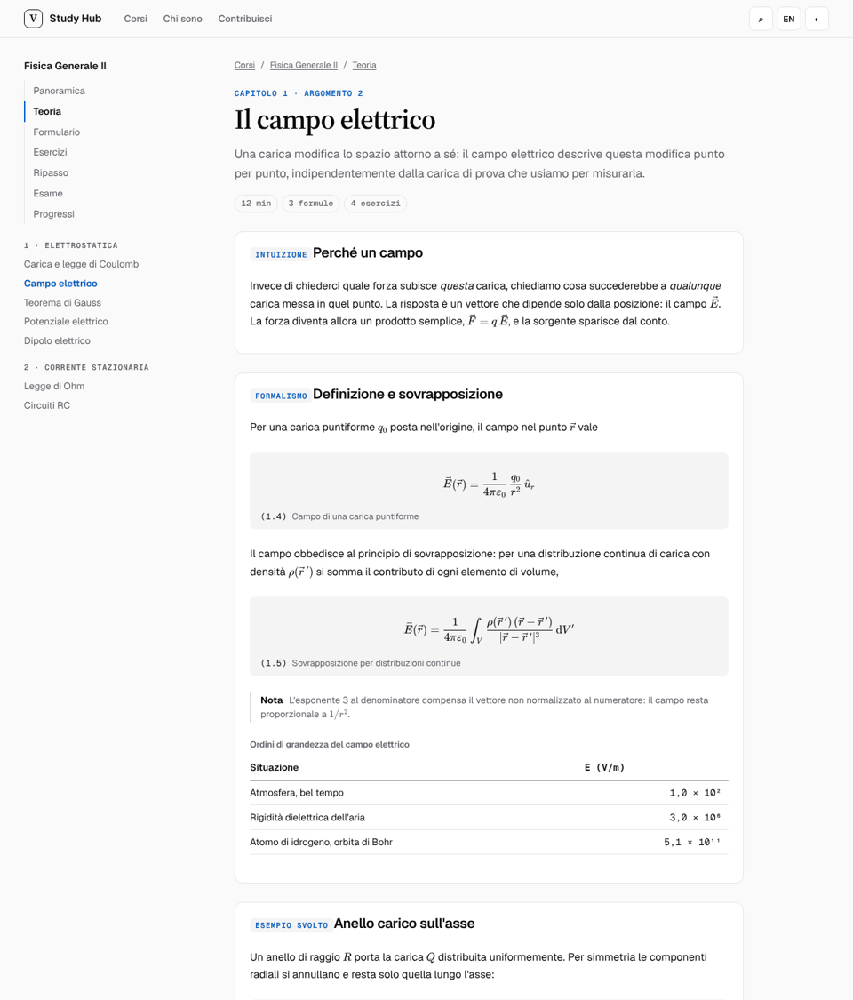
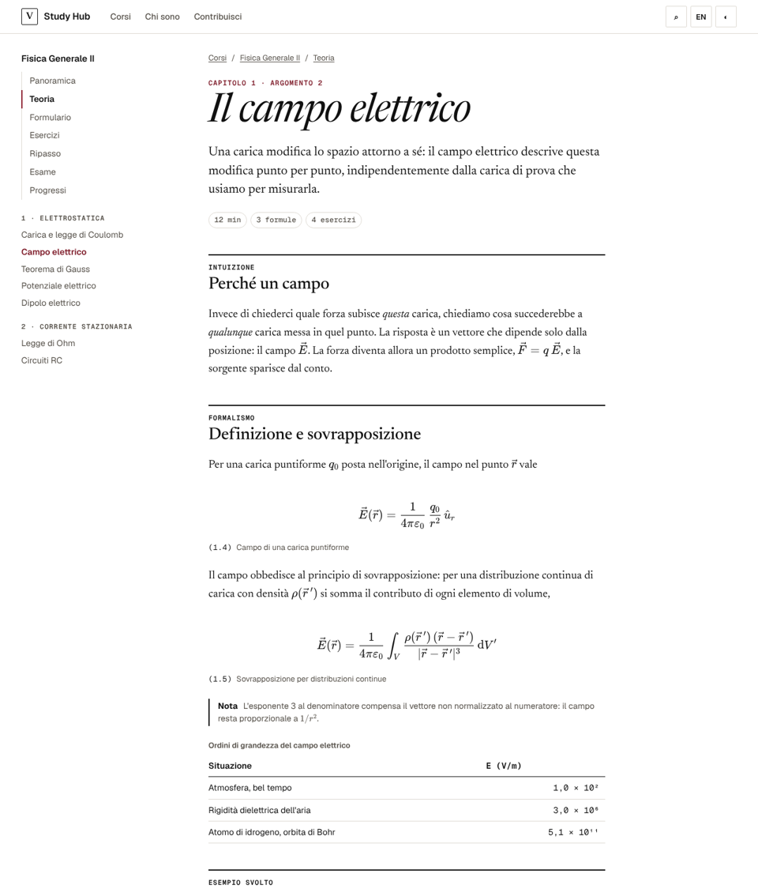
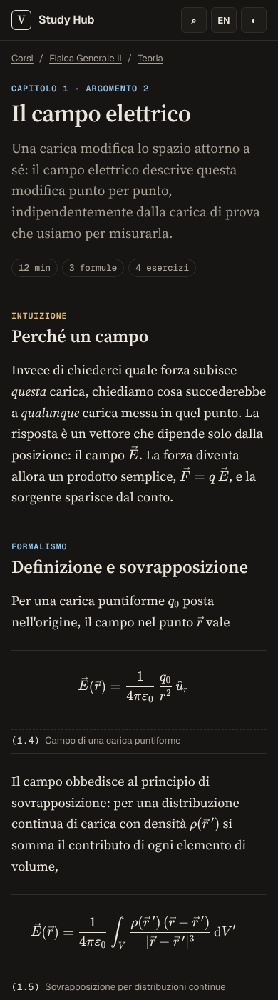
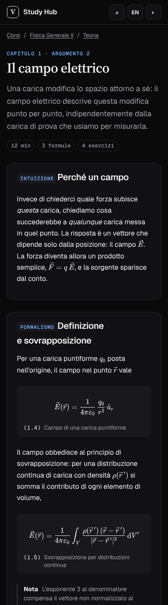
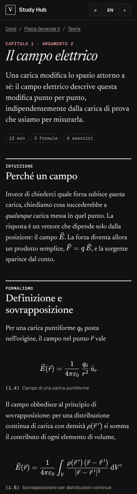
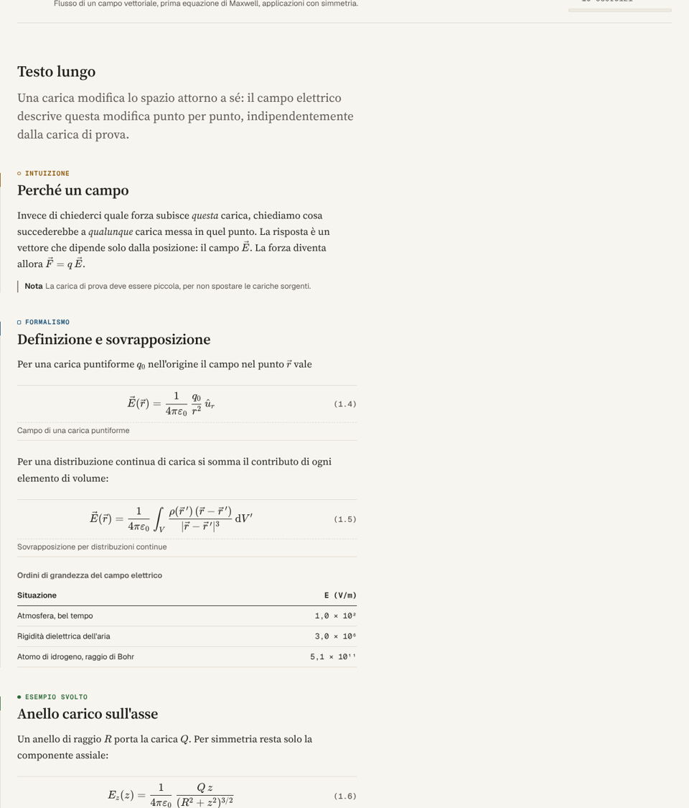
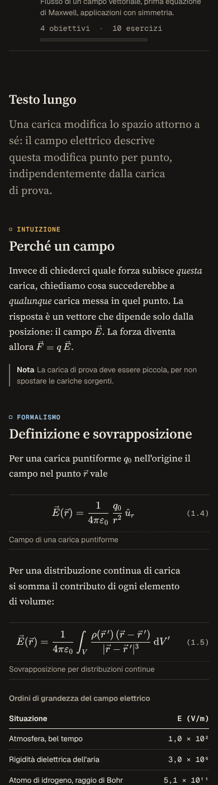

# Direzione visiva

Data: 2026-11-05. Scelta: **A — "Quaderno"**.

## Punto di partenza

- **Vecchio hub** (`legacy/hub/`): fondo quasi nero, sfere sfocate, griglia, vetro smerigliato, titoli con gradiente
  ciano-viola, pulsanti a pillola luminosi. Efficace come vetrina, ma è proprio l'estetica da evitare: decorazione che
  non porta informazione, contrasto debole del testo secondario, nessuna gerarchia per la lettura lunga.
- **Fisica 2** (`legacy/fisica-2/`): sistema pulito e funzionale (Geist, grigi neutri, un blu d'accento, raggi di 12 px,
  sommario laterale, pillole per i capitoli). Da qui vengono la **densità** (molte informazioni senza affollamento),
  la **colonna laterale** con il sommario, le **etichette in mono maiuscolo** e la scelta di **un solo accento**.
  Limiti: tutto in sans, formule in riquadri, molte "card" uguali, ritmo verticale uniforme che appiattisce la struttura.

Da conservare: la palette sobria, la densità e il sommario di Fisica 2; il marchio testuale e i dati in mono dell'hub.
Da abbandonare: vetro, gradienti, bagliori, pillole ovunque, testo lungo in sans.

## Tre prototipi

Stessa pagina (un argomento di teoria con i quattro strati, due formule numerate, una tabella, una nota, un esercizio,
un richiamo e la paginazione), resa con tre fogli di stile diversi, a 390 e 1280 px, in chiaro e in scuro.

| | A — Quaderno | B — Tecnico | C — Rivista |
|---|---|---|---|
| Testo | Source Serif 4, 18 px, 68ch | Geist, 16 px, 72ch | Newsreader, 19 px, 64ch |
| Titoli | serif semibold | serif per h1, sans per h2 | serif corsivo grande |
| Strati | etichetta mono colorata + filo nel margine | riquadri bordati con etichetta | filetto nero spesso |
| Formule | filetti sopra/sotto, numero a destra | riquadro grigio | libere |
| Fondo | carta calda `#f7f5f0` / `#161513` | grigio neutro | bianco puro / nero |

  

  

## Valutazione

**Leggibilità del testo lungo con formule.** In A il serif a occhio medio-grande si accorda con KaTeX (anch'esso un
serif): le formule in linea non "saltano" rispetto al testo, cosa che in B (sans + formule serif) si nota a ogni
simbolo. C legge bene ma Newsreader ha un occhio piccolo: a 390 px il corpo deve salire a 19 px e le righe diventano
corte (35-38 caratteri).

**Struttura.** I quattro strati (intuizione → formalismo → esempio → errori) sono il cuore didattico. In B diventano
quattro riquadri identici: la pagina è una pila di card, esattamente il cliché da evitare. In C il filetto nero spesso
separa bene ma pesa e non distingue gli strati tra loro. In A l'etichetta in mono colorata con un piccolo simbolo
(cerchio, quadrato, pieno, rombo: distinguibili anche senza colore) e il filo nel margine danno la struttura senza
chiudere il testo in scatole.

**Tabelle ed esercizi.** Uguali nei tre (componenti condivisi); in A il fondo caldo fa risaltare la superficie più
chiara dell'esercizio senza bisogno di ombre.

**Contrasto AA.** Tutti e tre superano AA; A con margine maggiore sul testo secondario (`--text-muted` 6,5:1 sul fondo).
Il nero/bianco puro di C in scuro abbaglia sulle formule.

**Ritmo verticale.** A e C hanno una spaziatura che cresce con il livello (strato > paragrafo > riga); B ha un ritmo
uniforme dovuto ai riquadri.

**Distintività.** B somiglia a mille documentazioni tecniche; C a una rivista e rischia l'affettazione (titoli corsivi);
A ha un carattere riconoscibile — un quaderno di appunti ordinato — coerente con siti di studio scritti da uno studente.

## Scelta e rifiniture

**A — Quaderno**, con queste rifiniture rispetto al prototipo:

- Source Serif 4 con **asse ottico** (`opsz`): titoli più stretti e contrastati, testo corrente più robusto.
- Strati con simbolo oltre al colore; filo nel margine solo da 1024 px (su mobile toglierebbe spazio).
- Indice degli argomenti come **indice di un libro** (numero in mono, titolo serif, sintesi, metadati e avanzamento
  sottile), non come griglia di card.
- Dal prototipo C: il filetto spesso solo dove serve un inizio forte (indice, "in breve", intestazioni di tabella).
- Quattro tinte d'accento da inchiostri tradizionali (terracotta, verde abete, blu di Prussia, prugna) verificate
  AA in entrambi i temi da `tests/unit/design-tokens.test.ts`.

Risultato finale (pagina `/it/stile/`):

 
